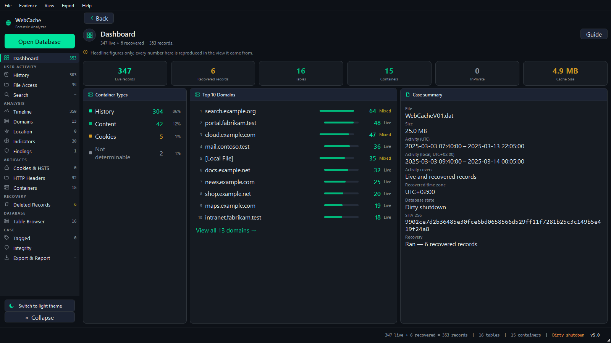
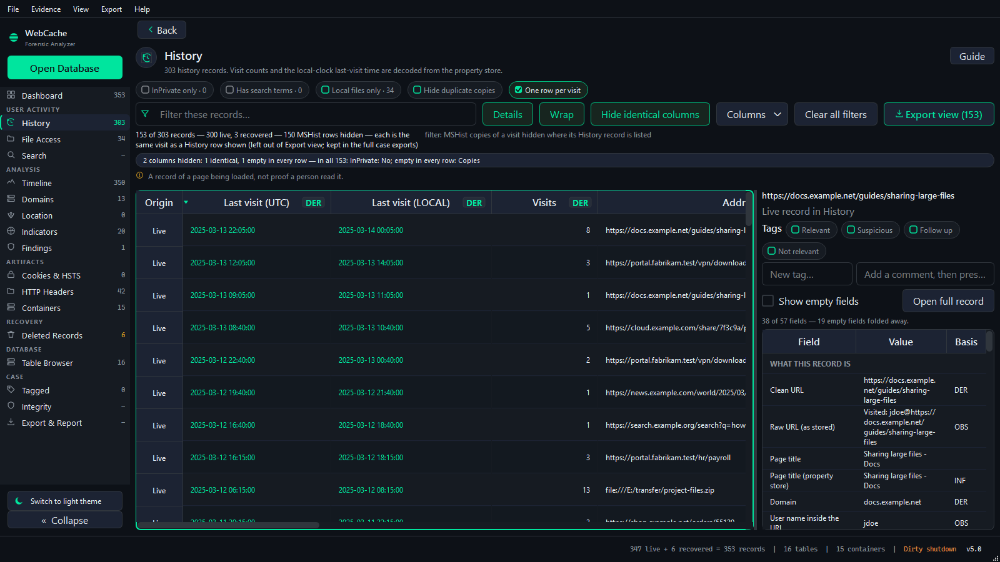
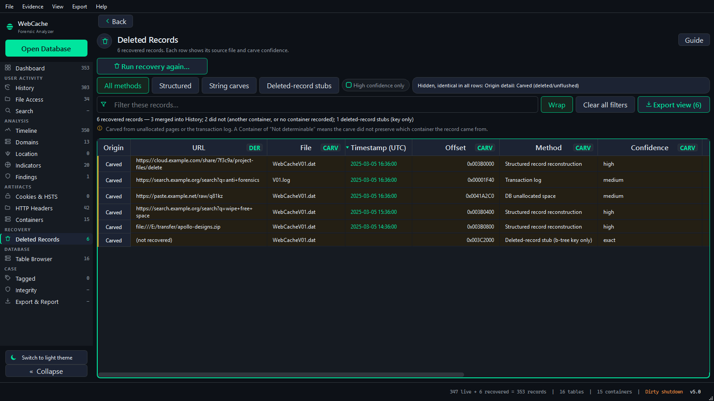
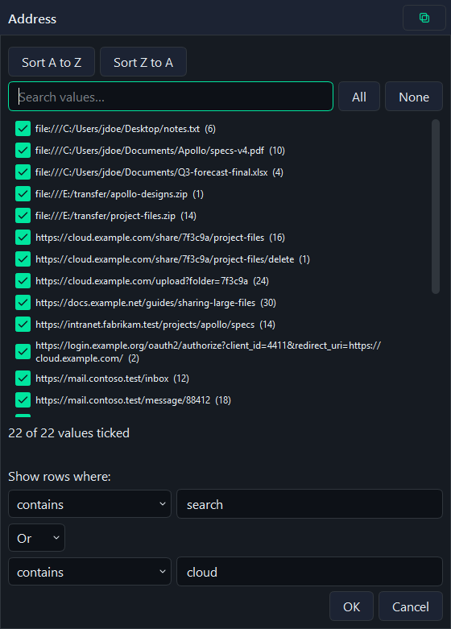
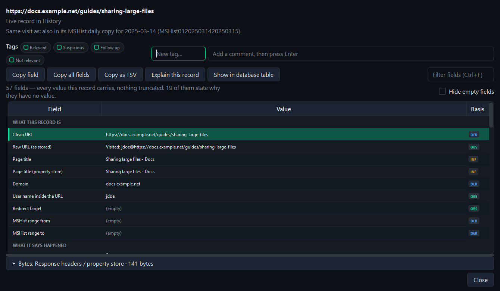
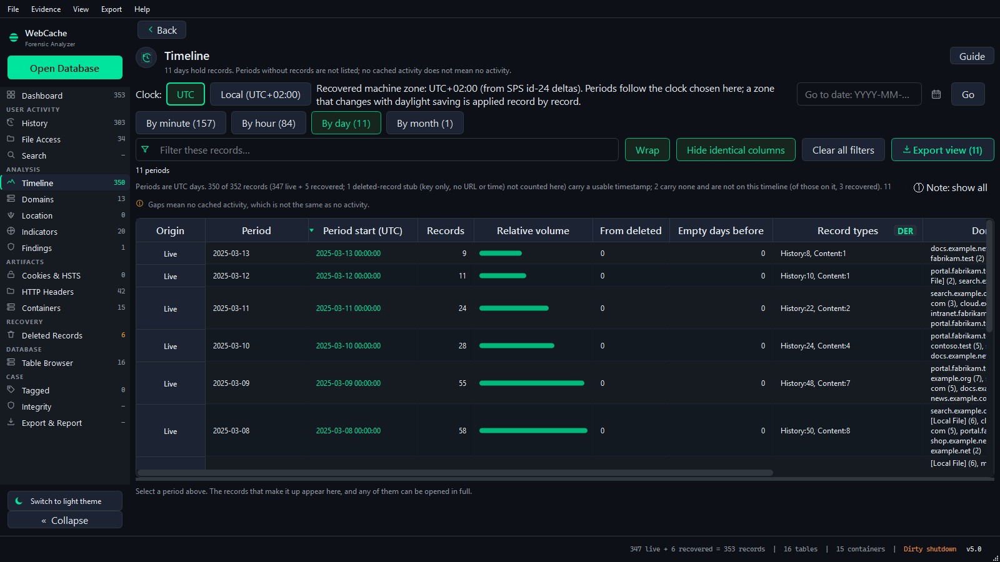
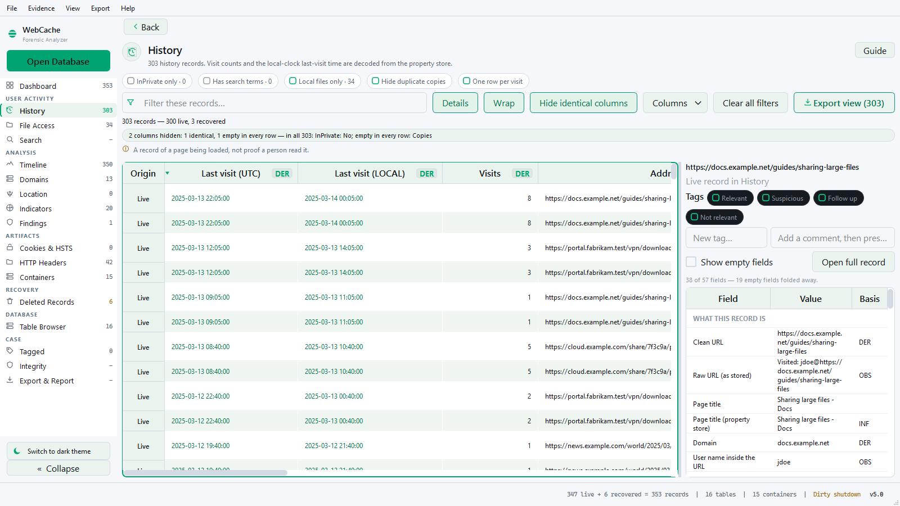
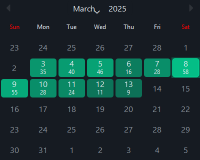
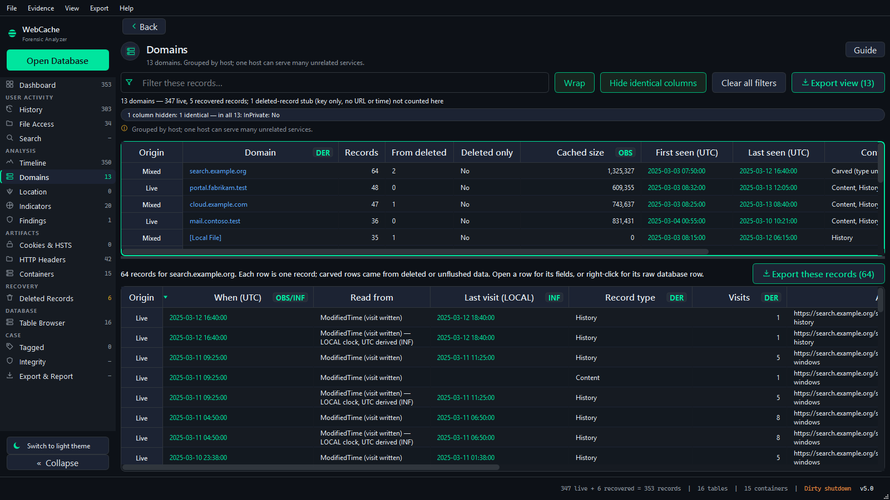

# WebCache Forensic Analyzer

A Windows desktop application for the forensic examination of
`WebCacheV01.dat`, the database in which Windows records web and app activity
for Internet Explorer, legacy Edge, and the many Windows components and
packaged apps that use the same cache.

It opens evidence strictly read-only, hashes every file it reads, recovers
deleted and unflushed records, and states for every value where it came from
and how it is known.



## Why this tool exists

`WebCacheV01.dat` is one of the richest records of activity on a Windows
machine, and one of the hardest to read correctly.

- **It is almost never clean.** The database is held open while the user is
  logged on, so an acquired copy is nearly always in a dirty-shutdown state,
  with recent changes still in its transaction logs. A reader that requires
  a clean database, or repairs one before reading it, either fails or
  destroys the very records an examiner needs.
- **Deletion is not erasure.** Records removed by the cache remain in
  unallocated database pages and in the transaction logs. On a typical
  machine many times more history survives there than in the live tables,
  and some artifacts, such as the positions Windows sends to its news and
  weather feed, are often found only there.
- **Its clocks disagree.** Some containers store UTC, others the machine's
  local time without saying so. Reading every timestamp as UTC silently
  shifts part of a timeline by hours.
- **Its values are encoded.** Visit counts, titles, download details and
  headers sit in binary property stores and blobs that a generic database
  viewer shows as hex.
- **A finding must survive review.** An examiner has to be able to show
  which file and byte offset a value came from, whether it was read directly
  or derived, and that the evidence was never altered.

This tool was written to meet those requirements together, in one place.

## What it does

- **Reads dirty databases as they are.** No repair, no soft recovery, no
  writes: the evidence folder is never modified, and every file read is
  hashed (SHA-256) when it is opened.
- **Recovers deleted and unflushed records** from unallocated pages and the
  transaction logs. Every recovered record carries its source file, byte
  offset, recovery method and confidence, and stays visibly apart from live
  records.
- **Puts both clocks right.** Each timestamp is shown in UTC and in the
  machine's local time, using the time zone recovered from the evidence
  itself.
- **Decodes what is stored in binary**: visit counts and last-visit times,
  page titles, download records, HTTP headers, cookies, HSTS pins and cached
  certificates.
- **Shows provenance for every value.** Each field states whether it was
  read as stored, derived from stored data, or recovered by carving, and a
  hex viewer shows the bytes behind any blob.
- **Sixteen views** over one exhibit: Dashboard, History, File Access,
  Search, Timeline, Domains, Location, Indicators, Findings, Cookies & HSTS,
  HTTP Headers, Containers, Deleted Records, Table Browser, Integrity, and
  Export & Report.
- **Filters every column**, including whether a row is live or recovered,
  with value lists, conditions joined by And / Or, and `*` / `?` wildcards.
- **Exports what is on screen, with the filters that produced it**: CSV, an
  Excel workbook, JSON, SQLite, a PDF report, a self-contained offline HTML
  report, and a complete case bundle with a SHA-256 manifest.
- **Keeps case notes** (tags, comments and case details) keyed to the
  exhibit's SHA-256, and never beside the evidence.

| | |
|---|---|
|  |  |
| **History.** Every visit with its decoded title, visit count and both clocks. | **Deleted Records.** Each recovered record with its file, offset, method and confidence. |
|  |  |
| **Filtering.** Sort, tick values, or combine two conditions. | **A record in full.** Every field, untruncated, with how each value is known. |
|  |  |
| **Timeline.** By minute, hour, day or month, in UTC or local time. | **Light theme.** The same views for printing and bright rooms. |
|  |  |
| **Date calendar.** Each day shows how many records it holds; busier days are deeper. | **Domains.** Every host, its records live and recovered, opened in place. |

*Screenshots show a fictional demonstration exhibit, not real evidence.*

## Documentation

- [How it works](docs/architecture.md): the components, the path from
  evidence to report, and the rules the design keeps.
- [Validation](docs/validation.md): the parser checked table by table and
  cell by cell against three independent ESE readers.
- [Location in WebCacheV01.dat](docs/how-location-is-found.md): where
  positions come from, how they are recovered, and what they support.

## Installing

Download the [latest release](https://github.com/akhil-dara/WebCache-Forensic-Analyzer/releases/latest)
for Windows 10 or 11 (64-bit). Nothing else needs to be installed.

| File | Description |
|---|---|
| `WebCacheAnalyzer-<version>-setup.exe` | **Installer (recommended).** Installs for the current user without administrator rights, or for all users when run as administrator. Adds a Start menu entry and an uninstaller. |
| `WebCacheAnalyzer-<version>-portable.zip` | Portable folder. Unzip anywhere and run `WebCacheAnalyzer.exe`. |
| `WebCacheAnalyzer-<version>-portable.exe` | Single portable file. It unpacks on each launch, so it starts more slowly. |
| `SHA256SUMS.txt` | Checksums for the three files above. |

Silent installation: `WebCacheAnalyzer-<version>-setup.exe /VERYSILENT /CURRENTUSER`,
or `/ALLUSERS` from an elevated prompt.

The builds are not code-signed, so Windows SmartScreen may warn on first
run. Verify the download against `SHA256SUMS.txt`, then choose
**More info → Run anyway**.

### Where case files are kept

- **Portable copy:** a `cases` folder beside the program, so case work
  travels with it.
- **Installed copy:** `%LOCALAPPDATA%\WebCacheAnalyzer`. Uninstalling does
  not delete it.
- **A folder of your choice:** *File → Case files folder…* shows the folder
  in use and changes it. Existing case files are copied, and a folder inside
  the evidence folder is refused.
- The `WEBCACHE_DATA_DIR` environment variable moves settings and case files
  together.

## Running from source

```
pip install .
python -m webcache
```

Requires Python 3.13 or later. To run the tests: `pip install ".[dev]"`,
then `pytest`.

## License

Released under the [GNU Affero General Public License v3.0](LICENSE).
© 2026 Akhil Dara.
