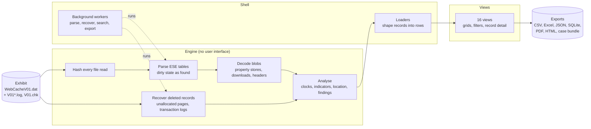

# How it works

WebCache Forensic Analyzer is a Python application with a PySide6 (Qt)
interface. It is built in three layers, and evidence only ever flows one
way: from the exhibit, through the engine, to what the examiner sees and
exports.

## The engine

The engine reads and interprets evidence. It has no user interface, so
every rule in it can be tested on its own.

| Component | Responsibility |
|---|---|
| `ese_parser` | Opens the database read-only, hashes it and its sibling files, reads every table in its dirty state without repair through dissect.esedb, records each parsing decision in a log, and recovers the machine's time zone from the evidence |
| `ese_records` | Decides what counts as a record. B-tree nodes too short to hold a record header are refused, as other ESE readers refuse them |
| `sps_decoder`, `download_decoder`, `blob_reader` | Decode the binary values a generic viewer shows as hex: property stores (visit counts, local-clock visit times), download records, headers |
| `local_clock` | Tells which containers store the machine's local time rather than UTC, and converts them using the recovered zone |
| `recovery_engine`, `struct_carver`, `carve_reader` | Recover deleted and unflushed records from unallocated pages and the transaction logs, record the file, offset, method and confidence of each, and read a carve back from the exhibit so it can be checked |
| `url_intel`, `geolocation` | Read what request URLs carry: identifiers, timestamps, addresses, and positions with their accuracy |
| `forensic_engine`, `analysis_extra` | Search, statistics, timelines, domains, findings, and the canonical record schema every export is written from |
| `evidence_model` | States how each field is known: read as stored, derived from stored data, or recovered by carving |
| `case_db` | Tags, comments and case details in a SQLite file keyed to the exhibit's SHA-256, kept outside the evidence folder |

## The shell

The shell connects the engine to the views.

- **Loaders** turn engine records into the rows each view shows, one module
  per view, so a view never interprets evidence itself.
- **Workers** run parsing, recovery, search, timeline building and exports
  off the interface thread. The window stays usable on a large exhibit, and
  every long task can be cancelled.
- **Export targets** refuse any destination inside the evidence folder.
- **The offline report** packs the views, their rows and their filters into
  one self-contained HTML file that opens in any browser with nothing
  installed and nothing fetched.

## The views

Every record-set view shares one grid, one filter engine and one record
detail dialog, so filtering, sorting, copying and provenance behave the
same everywhere.

- **The grid** marks every row live or recovered, and recovered rows are
  tinted so they are never mistaken for live ones.
- **The filter engine** combines value lists, conditions joined by And / Or,
  wildcards and quick filters. The filters in force are stated on screen and
  written into every export.
- **The record detail** shows every field of one record, untruncated, with
  how each value is known, and a hex view of any stored blob.

## From exhibit to report

1. **Open.** The examiner chooses the database. The files beside it (the
   transaction logs and checkpoint) are listed with their roles, and the
   examiner chooses which are read. Every chosen file is hashed.
2. **Parse.** Every table is read as found. Nothing is written, and no
   repair or soft recovery is run.
3. **Recover.** Deleted and unflushed records are carved from unallocated
   pages and the chosen logs. Each keeps its source file and byte offset.
4. **Interpret.** Blobs are decoded, local-time containers are converted,
   and URLs are read for indicators and positions.
5. **Examine.** The views present live and recovered records together,
   always labelled.
6. **Export.** What is on screen is written with the filters that produced
   it, a provenance record, and SHA-256 hashes.

## Design rules

- **Read-only.** The evidence folder is never written to, and nothing in the
  evidence is ever opened or executed. Paths are shown and copied, never
  launched.
- **Every value has a source.** A value is either read as stored, derived
  from stored data, or recovered by carving, and it says which.
- **Recovered is never blended with live.** Recovered records are labelled
  everywhere they appear, in the views and in every export.
- **Nothing is fetched.** No lookups and no network requests. Map links are
  text.
- **One definition of a record.** Every view, count and export uses the
  same rule for what a record is, so the numbers agree everywhere.
